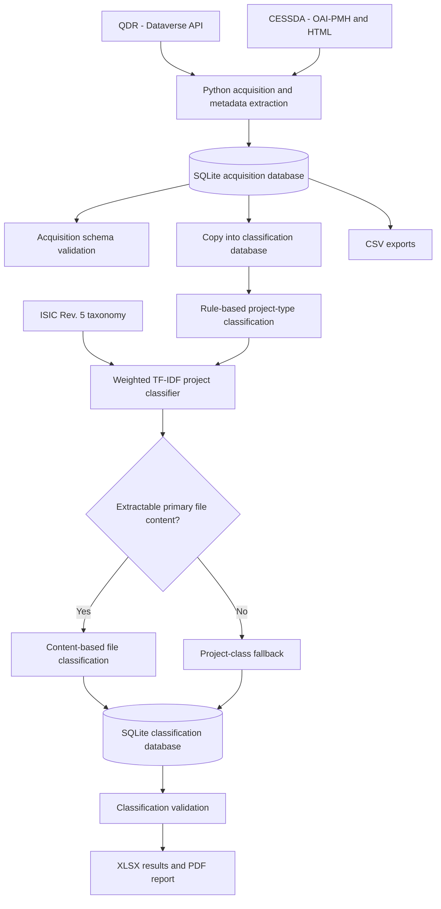

<h1 align="center">QDArchive Data Pipeline</h1>

<p align="center"><strong>Automated Research Data Acquisition, Classification &amp; Analytics</strong></p>
<p align="center">Academic Project · Friedrich-Alexander-Universität Erlangen-Nürnberg (FAU)</p>

<p align="center">
  
  
  
  
  
</p>
<p align="center">
  
  
  
</p>
<p align="center">
  <a href="#pipeline-architecture">Architecture</a> · <a href="#key-results">Results</a> · <a href="#classification-methodology">Classification</a> · <a href="#installation-and-usage">Usage</a> · <a href="#limitations">Limitations</a>
</p>

---

## Project Overview

An end-to-end Python and SQLite data engineering pipeline developed as part of the Seeding QDArchive academic project at FAU Erlangen-Nürnberg. The system acquires, organizes and classifies qualitative research metadata from the Qualitative Data Repository (QDR) and CESSDA Data Catalogue.

The project addresses fragmented research metadata, heterogeneous file formats and limited access to primary qualitative data. It combines API-based acquisition, ETL processing, relational storage, text classification, data validation and automated reporting.

- **Part 1 — Acquisition:** Search source repositories, collect metadata, record file access outcomes and store structured records in SQLite.
- **Part 2 — Classification:** Identify project types, assign ISIC Rev. 5 divisions to relevant projects and primary file records, validate results and generate analytical reports.

## Key Results

| Metric | Documented result |
|---|---:|
| Research projects processed | 62 |
| File records collected | 4,087 |
| Keywords extracted | 352 |
| Person-role records | 156 |
| License records | 62 |
| Relevant projects classified using ISIC Rev. 5 | 32 |
| Primary file records processed for classification | 3,724 |
| Independent content classifications | 87 |
| Project-class fallback classifications | 3,637 |
| ISIC Rev. 5 divisions imported | 87 |
| SQ26 acquisition database validation | 10 checks passed |
| Acquisition validation warnings / errors | 0 / 0 |

> Results describe the documented academic submission snapshot, not a fresh execution. File records are not equivalent to successful downloads. Classification confidence is not measured classification accuracy.

## Core Technical Contributions

- Automated metadata acquisition through Dataverse API and OAI-PMH, supplemented by HTML link extraction.
- Relational SQLite storage, deduplication by project URL, license normalization and download outcome tracking.
- Rule-based project-type classification and weighted word-level / character-level TF-IDF classification.
- ISIC Rev. 5 project and primary-file categorization with explicit evidence modes and confidence labels.
- Database validation, CSV and XLSX export, repository-specific statistics and PDF report generation.

## Pipeline Architecture



## Data Acquisition

| Source | Access method | Data collected |
|---|---|---|
| [Qualitative Data Repository (QDR)](https://qdr.syr.edu/) | Dataverse API (`/search`, `/datasets`) | Dataset metadata, file metadata, available files |
| [CESSDA Data Catalogue](https://datacatalogue.cessda.eu/) | OAI-PMH `ListRecords` and HTML link extraction | Catalogue metadata, publisher links and accessible files |

Search terms include qualitative research, interviews, focus groups, ethnography and QDA-specific file formats such as QDPX, NVivo and MAXQDA. Metadata fields include titles, descriptions, keywords, contributors, roles and licenses. Restricted downloads and failed requests are recorded rather than treated as successful acquisitions.

The acquisition modules use request timeouts and delays, project URL deduplication and download checks. Target formats include `.qdpx` and `.nvpx`; accessible supporting files may include PDF, text, CSV, Excel, ZIP, JSON and XML.

| Challenge | Implementation approach |
|---|---|
| Duplicate datasets | Deduplicate using project URL |
| Inconsistent license metadata | Normalize available license information |
| Restricted access | Record failure outcomes; do not bypass access controls |
| Missing CESSDA file links | Extract candidate links from publisher HTML |
| Invalid download responses | Check response content rather than assuming a file was retrieved |

## Database Schema

The acquisition database contains five core relational tables. Classification is performed on a separate database copied from the acquisition snapshot.

| Table | Purpose |
|---|---|
| `projects` | Dataset-level metadata and project classification |
| `files` | File metadata, access outcome and file classification |
| `keywords` | Project keywords |
| `person_role` | Contributor names and roles |
| `licenses` | License information |
| `isic_divisions` | ISIC Rev. 5 division taxonomy |
| `classification_inputs` | Prepared classification evidence |
| `project_classifications` | Detailed project classification results |
| `file_classifications` | File-level results, confidence and evidence mode |

The last four tables belong to the classification stage. The classification database extends the base schema with `projects.type`, `projects.class` and `files.class`. See [database implementation](src/db.py) and [classification validation](src/validate_classification_results.py).

## Classification Methodology

### 1. Rule-based project types

The project type is assigned using the available file evidence in the documented priority order:

1. Known QDA file → `QDA_PROJECT`
2. Otherwise, primary qualitative data → `QD_PROJECT`
3. Otherwise, another valid project data file → `OTHER_PROJECT`
4. Otherwise → `NOT_A_PROJECT`

| Project type | QDR | CESSDA | Total |
|---|---:|---:|---:|
| QDA_PROJECT | 2 | 0 | 2 |
| QD_PROJECT | 14 | 16 | 30 |
| OTHER_PROJECT | 0 | 21 | 21 |
| NOT_A_PROJECT | 0 | 9 | 9 |
| **Total** | **16** | **46** | **62** |

Only the 32 QDA_PROJECT and QD_PROJECT records proceed to ISIC classification.

### 2. ISIC Rev. 5 project classification

The classifier compares prepared text evidence against profiles for 87 ISIC Rev. 5 divisions using TF-IDF and cosine similarity. Generic academic terms are reduced so that domain-related evidence carries more weight.

| Evidence field | Configured weight |
|---|---:|
| Project title | 30% |
| Description | 30% |
| Keywords | 20% |
| Extracted file content | 15% |
| Useful file names | 5% |

The implementation combines word-level similarity (80%) and character-level similarity (20%). Detailed scores, secondary candidates and confidence labels are retained. See [project classifier](src/classify_isic_projects.py).

| Confidence label | Projects |
|---|---:|
| Medium | 16 |
| Low | 16 |
| **Total** | **32** |

All 32 relevant projects were assigned a division in the documented snapshot. Examples include human health activities (R86), employment activities (O78), education (Q85), retail trade (G47) and residential care activities (R87). These are heuristic assignments; no independently labeled accuracy benchmark is reported here.

### 3. Primary-file classification

The file classifier distinguishes extractable independent content from cases where direct evidence is unavailable. Its configured evidence weights are file content (70%), filename (20%) and project context (10%), with word/character similarity combined as above. See [file classifier](src/classify_isic_files.py).

| Evidence mode | File records | Share |
|---|---:|---:|
| INDEPENDENT_CONTENT_CLASSIFICATION | 87 | 2.34% |
| PROJECT_CLASS_FALLBACK | 3,637 | 97.66% |
| **Total** | **3,724** | **100%** |

Fallback means the file inherits its project's assigned class; it is not an independently established classification. The evidence mode is stored explicitly in `file_classifications`.

## Validation and Data Quality

The original acquisition submission reports **10 checks passed, 0 warnings and 0 errors** using the strict SQ26 validator.


Classification validation checks required tables, columns, project types, expected counts and classification consistency. See [validation source](src/validate_classification_results.py). Schema validation does not establish semantic accuracy.

## Installation and Usage

### Prerequisites

- Python 3.10 or newer recommended (the source uses modern type annotations).
- Git and a terminal; internet access for live acquisition.
- The ISIC workbook and authorized local research files for full classification reproduction.

```bash
git clone https://github.com/MD-IKRAM169/Qdarchive-data-pipeline.git
cd Qdarchive-data-pipeline
python -m venv .venv
```

Activate the virtual environment:

```powershell
# Windows PowerShell
.\.venv\Scripts\Activate.ps1
```

```bash
# Linux / macOS
source .venv/bin/activate
```

```bash
python -m pip install -r requirements.txt
```

### Inspect the submitted snapshot

The database filenames follow the original academic submission convention and are referenced by the existing scripts. Run these commands from the repository root, with the submitted databases present:

```bash
python check_submission.py --strict 23158587-seeding.db
python -m src.validate_classification_results
```

The classification validator expects the original 62-project snapshot. It is not a general-purpose validator for newly collected datasets. The commands are based on existing documentation and code; a clean-environment run has not been independently verified for this README revision.

### Run live acquisition (optional)

Use a separate working copy and back up the submitted databases and exports first. Live acquisition contacts external repositories, can modify the acquisition database, and may download files. Respect source terms, licenses and access restrictions.

```bash
python -m src.run_all
python -m src.csv_export
```

`run_all.py` currently uses per-query acquisition limits of 2 for QDR and 5 for CESSDA. Current source availability and metadata may differ from the original snapshot.

### Rebuild classification (optional)

The following is the intended sequence based on the existing modules. Work in a separate copy. Preserve the original classification database and exports; the preparation script does not overwrite an existing classification database. A fresh rebuild needs an acquisition database, the ISIC workbook, and any authorized local files needed for content-based classification.

```bash
python -m src.prepare_classification_db
python -m src.add_classification_columns
python -m src.classify_project_types
python -m src.import_isic_taxonomy
python -m src.prepare_classification_input
python -m src.classify_isic_projects
python -m src.classify_isic_files
```

The repository also provides `src/fix_file_classification_schema.py`, a schema-repair utility. It recreates the file classification table and should not be run on a populated results database without a backup. Use it only if the legacy schema requires repair, before rerunning the file classifier.

For the original snapshot (or after adapting snapshot-specific validation to a new dataset):

```bash
python -m src.validate_classification_results
python -m src.export_classification_xlsx
python -m src.generate_classification_report
```

Without the original authorized local files, the independent-content classification results may not be reproducible. Dependency versions are not fully pinned. This sequence documents the existing modules rather than claiming that an end-to-end rerun has been tested.

## Repository Structure

```text
Qdarchive-data-pipeline/
├── src/
│   ├── config.py
│   ├── db.py
│   ├── acquire_qdr.py
│   ├── acquire_cessda.py
│   ├── run_all.py
│   ├── csv_export.py
│   ├── prepare_classification_db.py
│   ├── add_classification_columns.py
│   ├── classify_project_types.py
│   ├── import_isic_taxonomy.py
│   ├── prepare_classification_input.py
│   ├── classify_isic_projects.py
│   ├── classify_isic_files.py
│   ├── fix_file_classification_schema.py
│   ├── validate_classification_results.py
│   ├── export_classification_xlsx.py
│   └── generate_classification_report.py
├── exports/
├── my_downloads/
├── schema-definition/
├── validator/
├── check_submission.py
├── submission_precheck.py
├── validation_result.png
├── 23158587-seeding.db
├── 23158587-sq26-classification.db
├── ISIC5_Exp_Notes_11Mar2024.xlsx
├── requirements.txt
├── readme.md
└── LICENSE
```

Selected files and directories; the tree is not exhaustive.

## Outputs and Deliverables

| Output | Description |
|---|---|
| Acquisition SQLite database | Structured project and file metadata |
| Classification SQLite database | Project types, ISIC assignments and audit evidence |
| CSV exports (`exports/`) | Projects, files, keywords, person roles and licenses |
| XLSX classification results (`exports/`) | Project-level classification results |
| PDF classification report (`exports/`) | Repository/project-type distributions, histograms and ranked class tables |

[Browse exports](exports/) · [View source code](src/) · [View validation image](validation_result.png)

## Key Findings

- QDA-format records were found, but QDA projects were rare in this collected sample (2 of 62).
- QDR supplied both QDA and qualitative-data projects; CESSDA often supplied catalogue metadata rather than directly usable files.
- Access restrictions, incomplete metadata and limited extractable content constrained the analysis.
- The relevant projects span multiple ISIC domains; 16 of 32 project classifications were marked low confidence.
- Most file classifications were inherited from the project rather than established independently from file content.

## Limitations

- The search queries and per-query limits create a selected sample, not a representative census of qualitative research repositories.
- File accessibility and catalogue metadata change over time. Some files require authentication or cannot be retrieved.
- Extractable content is limited; file-level fallback dominates the submitted snapshot.
- TF-IDF scores and heuristic confidence labels are not calibrated probabilities or verified predictive accuracy.
- Snapshot-specific validation and unpinned dependencies limit general reproducibility.
- The original download files, extracted text, taxonomy workbook and metadata may be subject to third-party rights or access conditions. Public availability does not by itself authorize redistribution.

## Data Access and License

Obtain source data through the original repositories, following their licenses and access conditions. Only use local research files for which you have permission. The MIT software license does not grant rights to third-party datasets, documents, metadata or taxonomy materials. Review any included research data, database text and exports for permitted redistribution before sharing or reusing them.

See [LICENSE](LICENSE) for the repository software license.

## Author

**Md Ikram Tareq** · M.Sc. Data Science, FAU Erlangen-Nürnberg, Germany

Academic supervision: Prof. Dr. Dirk Riehle (Seeding QDArchive project).

[LinkedIn](https://www.linkedin.com/in/md-ikram-tareq/) · [Portfolio](https://md-ikram169.github.io/) · [GitHub](https://github.com/MD-IKRAM169)
